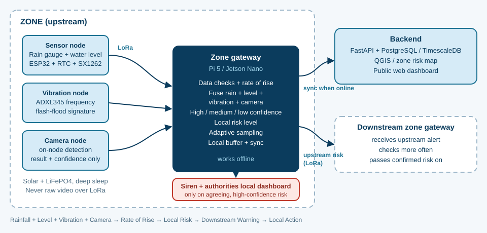

# Suchak

**A resilient, AI-powered environmental monitoring network for early detection and actionable alerts.**
Distributed sensor nodes + local zone gateways, linked over LoRa, that keep sensing and alerting when the Internet does not.

Submitted to **Smart India Hackathon 2026** as **VEGA — Environmental Intelligence Network** · Problem Statement [SIH26178](https://sih2026.vuce.in/ps/SIH26178) · Hardware · Disaster Management · Team **VE GA** (Team ID 155626)

<p align="center">
  
</p>

---

## Why

Environmental hazards such as floods can change locally and quickly, while centralized systems often lack ground-level, real-time data, and remote regions have sparse sensing and unreliable connectivity.

## Idea

Move sensing and first-level intelligence closer to the environment.

- **Sensor nodes** measure the hazard (current prototype: **flood**, via rainfall + water level).
- **Zone gateways** collect node data over **LoRa**, check data quality, compute risk locally and raise local alerts.
- **Cooperative warning**: when upstream risk rises, downstream zones increase their monitoring.
- **Offline-first**: sensing, edge processing, LoRa and local alerts continue without Internet; events are buffered and synced when connectivity returns.
- **Modular**: the same gateway, risk engine and dashboard can serve other hazards (smoke, air quality, heat, gas, soil moisture, vibration).

```
Environmental sensors  →  Edge AI  →  Local risk  →  Alert / Downstream warning  →  Regional map
```

## Status

This repo is at an early stage. Being explicit about what exists:

| Area | State |
|------|-------|
| Idea, architecture, SIH submission | Done — see [`docs/`](docs/) |
| Base node PCB (ESP32 + LoRa + power + USB-C) | **Reused from [CrashLink](https://github.com/surajjha0622/CrashLink)** — design files in [`hardware/base-node/`](hardware/base-node/). Needs changes for Suchak, see [hardware reuse notes](docs/hardware-reuse.md) |
| LoRa bring-up firmware | Draft sketch in [`firmware/bringup/`](firmware/bringup/), **not yet run on hardware** |
| Sensor drivers (rain gauge, water level, DS3231) | Planned |
| Local risk logic (rate of rise, adaptive sampling) | Planned — the first AI-free baseline |
| Edge AI / TinyML anomaly model | **Proposed**, to be developed and validated |
| Zone gateway (Raspberry Pi) + backend + dashboard | Planned |
| Field testing | Not started |

## Repository layout

```
Suchak/
├── docs/
│   ├── architecture.md        System design, data flow, offline behaviour
│   ├── hardware-reuse.md      What is reused from CrashLink and what must change
│   ├── feasibility.md         Engineering risks → mitigations
│   ├── roadmap.md             Bench test → field node → pilot → validate
│   ├── references.md          Research + component references
│   ├── assets/                Diagrams
│   └── presentation/          SIH 2026 submission deck (.pptx)
├── hardware/
│   └── base-node/             ESP32 + LoRa base board (from CrashLink relay node)
└── firmware/
    ├── common/                Board pin map
    └── bringup/lora_ping/     LoRa link test sketch
```

## Tech stack

| Layer | Choice |
|-------|--------|
| Node MCU | ESP32 |
| Radio | LoRa (deck specifies SX1262; the reused board currently carries an RFM95W / SX127x) |
| Timekeeping | DS3231 RTC |
| Power | Solar + LiFePO₄, deep sleep + RTC scheduling |
| Gateway | Raspberry Pi |
| Backend | Python, FastAPI, PostgreSQL / TimescaleDB |
| Mapping | QGIS / GIS |
| Edge ML | TensorFlow Lite for Microcontrollers (proposed) |

## Implementation path

1. **Bench test** — sensors + node + LoRa link on the desk
2. **Field node** — solar, enclosure, real rainfall / water level
3. **Multi-node pilot** — nodes + gateway across a zone, upstream/downstream sharing
4. **Validate + scale** — compare against observed events, tune risk logic and model

Details in [`docs/roadmap.md`](docs/roadmap.md).

## Related work

- [CrashLink](https://github.com/surajjha0622/CrashLink) — ESP32 + LoRa relay-network prototype by the same team; source of the base node PCB.

## Documents

- [SIH 2026 submission deck](docs/presentation/SIH2026-VEGA-SIH26178.pptx)
- [References](docs/references.md)

## License

MIT — see [LICENSE](LICENSE).
