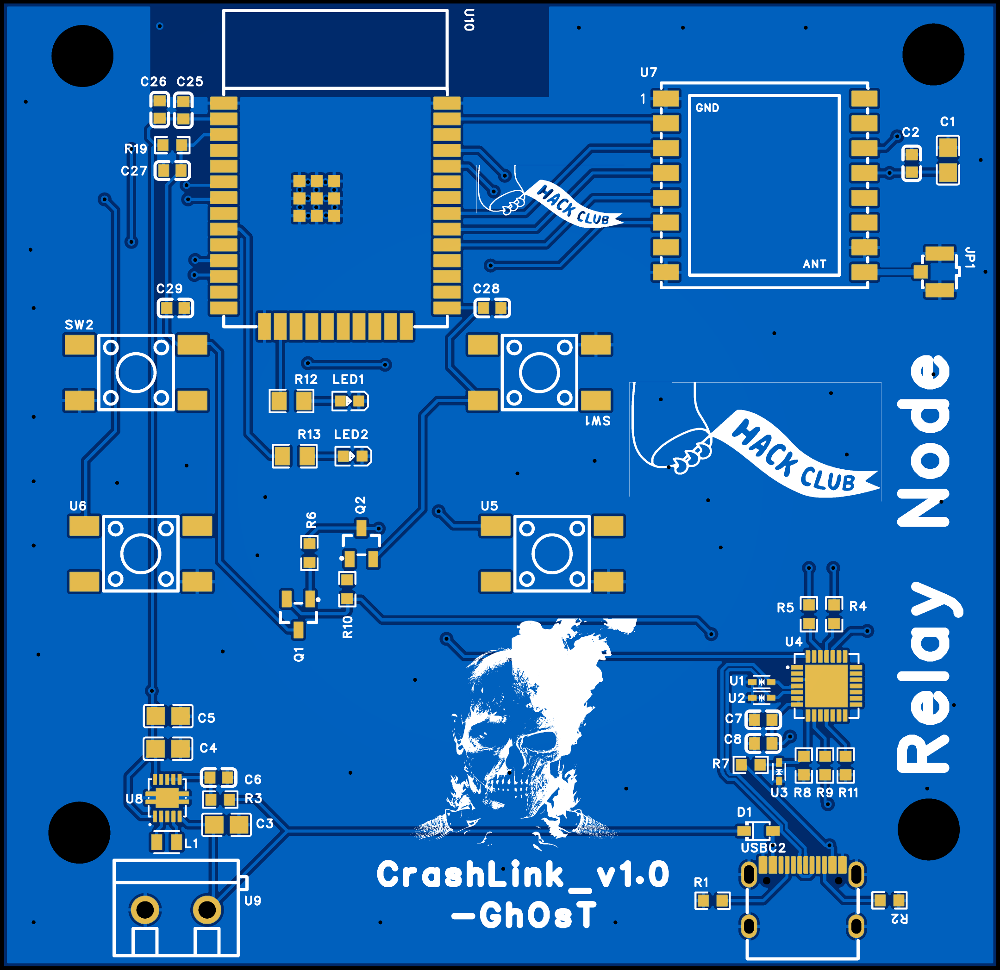
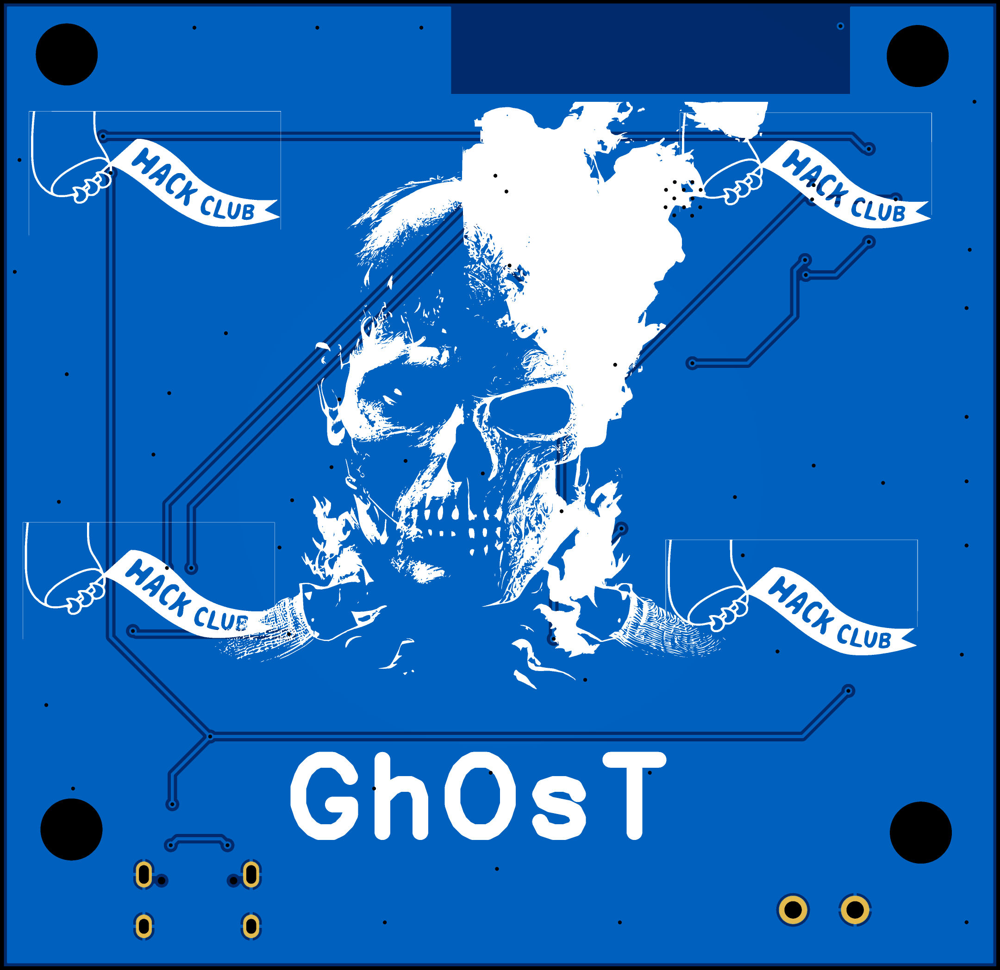
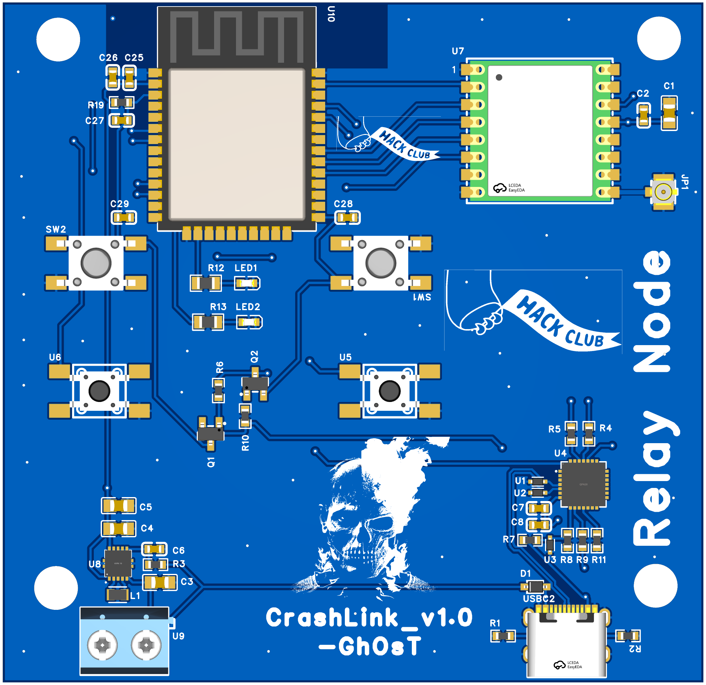

# Base node (Rev A)

ESP32 + LoRa + power + USB-C board, reused from the CrashLink relay node. It is the starting point for the Suchak sensor node and for the gateway's LoRa/USB bridge. **It is not yet the final Suchak board** — see [hardware-reuse.md](../../docs/hardware-reuse.md) for what has to change.

| Top | Bottom |
|-----|--------|
|  |  |

## Files

| File | Description |
|------|-------------|
| `source/BaseNode_RevA.epro2` | EasyEDA Pro project (editable source) |
| `BaseNode_RevA_schematic.pdf` | Schematic |
| `images/` | PCB 2D top/bottom and 3D renders |

The 3D STEP model (22 MB) and the enclosure CAD stay in CrashLink (`hardware/pcb/3D_RNode.step`, `hardware/case/Relay Node/`) to keep this repo light.

No Gerbers are included: CrashLink only has Gerbers for an older revision of this board. Export fresh ones from the EasyEDA project when ordering.

## Pin map (from the schematic)

| Function | ESP32 GPIO |
|----------|-----------|
| LoRa SCK | 18 |
| LoRa MOSI | 19 |
| LoRa MISO | 23 |
| LoRa NSS | 5 |
| LoRa RST | 26 |
| LoRa DIO0 | 27 |
| LED1 / LED2 | 13 / 33 |
| SW1 / SW2 | 35 / 34 (input-only pads) |
| USB-UART | UART0 (TXD0/RXD0) with auto-reset on EN/IO0 |

Same map in code: [`firmware/common/BaseNodeRevA_pins.h`](../../firmware/common/BaseNodeRevA_pins.h).

All other ESP32 pads are **not broken out** on Rev A.

## Main parts (read from the schematic)

| Ref | Part | Role |
|-----|------|------|
| U10 | ESP32-WROOM-32E-N8 | MCU |
| U7 | RFM95W-915S2 | LoRa radio |
| JP1 | U.FL connector | Antenna |
| U8 + L1 (2.2 µH) | TPS63001 | 3.3 V buck-boost |
| U9 | KF301-5.0-2P | Battery / power input terminal |
| U4 | CP2102N | USB-UART |
| USBC2 | TYPE-C-31-M-12 | USB-C |
| U1–U3 | LESD5D5.0CT1G | USB ESD protection |
| D1 | BAT760-7 | Schottky diode |
| Q1, Q2 | SS8050 | Auto-reset transistors |

This is a parts summary, not a manufacturing BOM. Generate the BOM and pick-and-place files from the EasyEDA project before ordering.

## Provenance

Copied from [CrashLink](https://github.com/surajjha0622/CrashLink) `hardware/pcb/` (`RNode.epro2`, `SCH_RNode.pdf`, `2D_RNode_*.png`, `3D_RNode.png`) at commit `b8a8dd2`. Design by Suraj Jha, MIT licensed.
